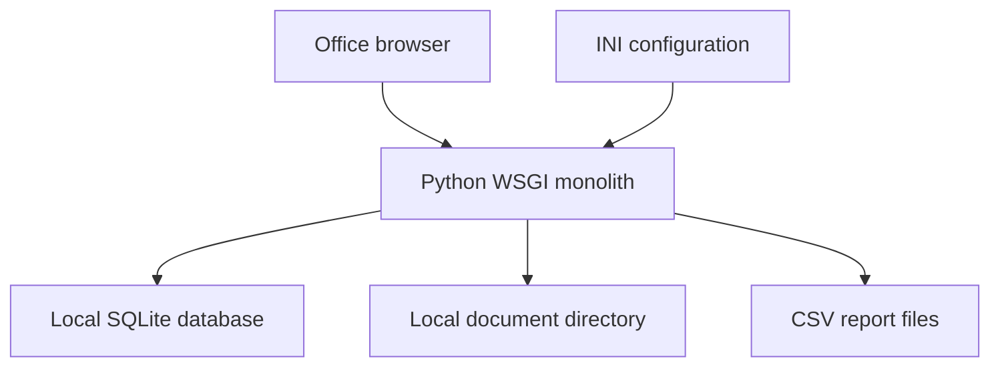

# Current-state assessment input

## Context

LedgerWorks is a fictional back-office order desk. One office operator uses a browser connected to a Python process on the same computer. This is a deliberately small legacy-style baseline for learning cloud migration.

## Architecture

## Dependencies and data

- Python standard library only; supported Python 3.11+ interpreter.
- `wsgiref.simple_server`: single-process development server on loopback.
- `sqlite3`: direct SQL inside application methods; no ORM or repository abstraction.
- `configparser`: local configuration, with paths relative to the INI file.
- `pathlib`: direct reads and writes to local directories.
- Three tables: customers, orders, documents. Foreign keys enforce relationships.
- Currency is USD and is stored as integer cents. Totals include cancelled orders; status filters affect rows, not dashboard totals. Preserve or explicitly approve a change to those semantics.
- Allowed status transitions: New → Processing or Cancelled; Processing → Shipped or Cancelled. Shipped and Cancelled are final.
- Uploaded file bytes live on disk; SQLite stores generated filename, original filename, order relationship, size, and SHA-256 hash.
- Timestamps use UTC strings generated by SQLite.
- Report CSV display fields are escaped for spreadsheet formula prefixes. This is a report, not a lossless database interchange format.

## Existing constraints

| Constraint | Why it matters during migration |
| --- | --- |
| Embedded database | Needs data export/import, schema translation, and connection changes |
| Direct SQLite SQL | SQLite-specific DDL, timestamps, generated IDs, placeholders, and transaction behavior must be reviewed |
| Documents on local disk | A stateless or scaled runtime cannot rely on a single instance's filesystem |
| Database/file dual write | A crash may produce orphan files or metadata without a readable file; reconciliation is needed |
| Single-process runtime | Concurrency, restart behavior, and production serving require design |
| Process-local form token | Restarts invalidate forms; independent instances do not share token state |
| No user identity | Cloud access control must be designed, not inferred from loopback access |
| Manual configuration and startup | Environment configuration and repeatable deployment are future work |
| Batch report writes a fixed filename | Scheduling, overwrite semantics, report retention, and destination need decisions |
| Basic terminal logs | Operational metrics, traces, audit events, and alerting are absent |

## Known training limitations

No pagination, editing/deleting customers, order line-item collections, inventory, payments, taxes, email sending, or multi-currency support. There is one product per order. Scope the migration around the actual implementation rather than expanding it into an ERP project.

No production hosting or availability, disaster recovery, performance, security, or cloud-cost claims are made.
